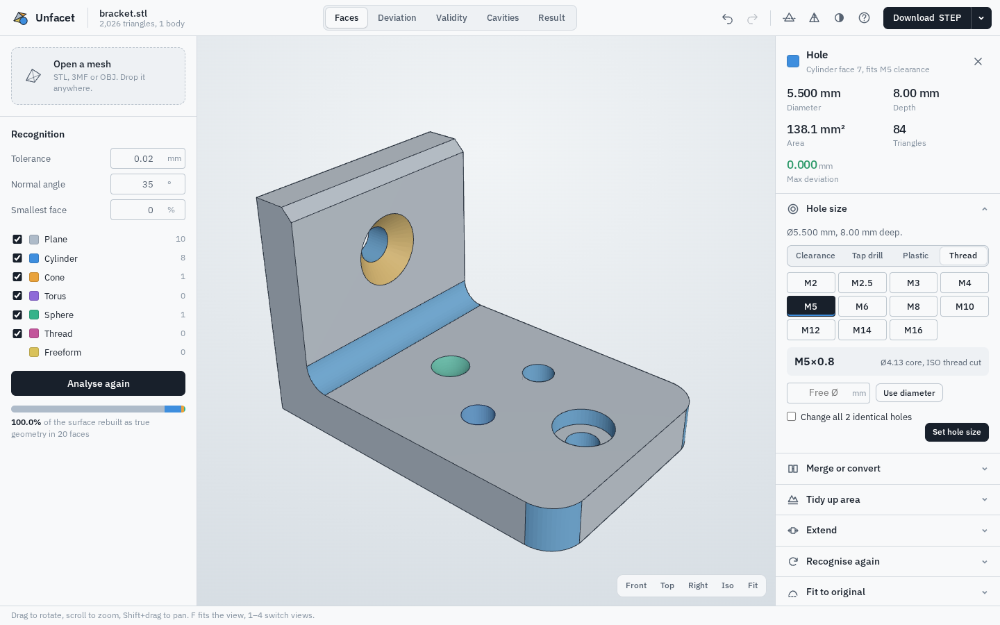
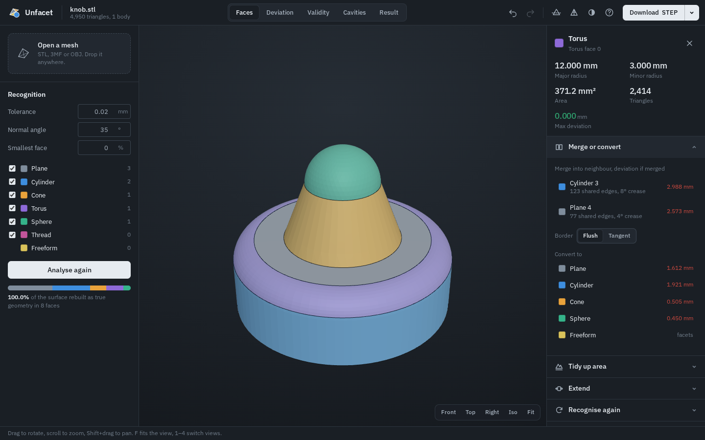
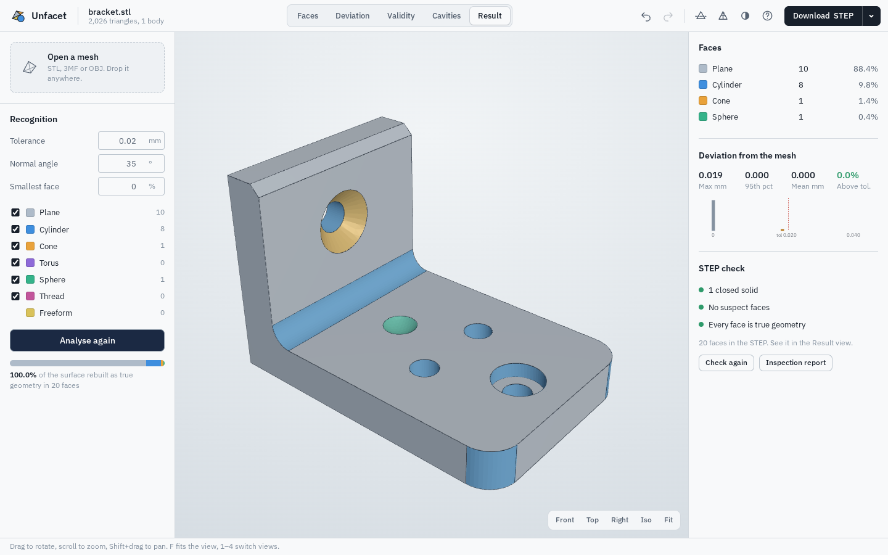
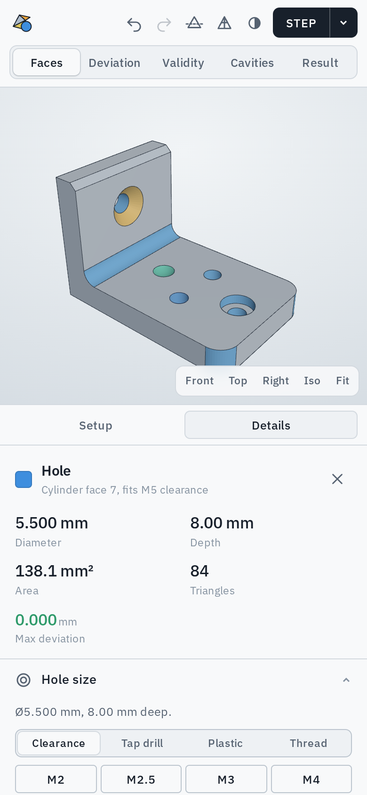
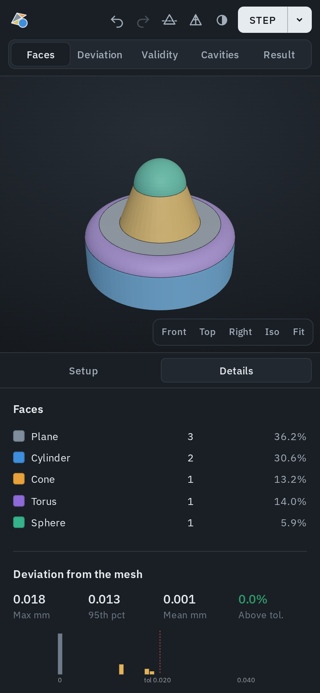

<p align="center"></p>

<h1 align="center">Unfacet</h1>

<p align="center">Self-hosted mesh → CAD converter: STL, 3MF and OBJ in, editable STEP solids out.</p>

<p align="center">
  <a href="https://github.com/au12/unfacet/actions/workflows/docker.yml"></a>
  <a href="https://github.com/au12/unfacet/pkgs/container/unfacet"></a>
</p>

Open a mesh, and Unfacet finds the planes, cylinders, cones, spheres, tori and threads in the triangles,
rebuilds them as true B-rep faces with OpenCascade, and gives you a STEP you can edit in Fusion,
SolidWorks, Onshape or FreeCAD: change hole diameters, move faces, add fillets.

Everything runs in one container on your own server. Meshes never leave your network.

## Screenshots

**Desktop**



| Merge or convert a face (dark theme) | Built STEP with its validity check |
|---|---|
|  |  |

**Mobile**

<p>
  
  &nbsp;
  
</p>

## Run it

The image is built by GitHub Actions and published to GHCR on every push to `main` (and tagged
`x.y.z` for `vx.y.z` git tags). GHCR packages start out private: after the first build, open the
package on GitHub → **Package settings** → **Change visibility** → Public, so Unraid can pull it
without logging in.

```bash
docker run -d --name unfacet -p 8080:8080 --restart unless-stopped ghcr.io/au12/unfacet:latest
# then open http://<server>:8080
```

Or with compose (`docker compose up -d`), or build it yourself with `docker compose up -d --build`.

### Unraid

1. From the Unraid terminal, fetch the template:
   ```bash
   wget -O /boot/config/plugins/dockerMan/templates-user/my-unfacet.xml \
     https://raw.githubusercontent.com/au12/unfacet/main/unraid/unfacet.xml
   ```
   Then in the Docker tab choose **Add Container** and pick **unfacet** from the template list.
2. Set the port and options below, then **Apply**. No appdata path is needed.
3. Put it behind Nginx Proxy Manager like any other web app; it needs no websockets and sits fine on a
   sub-domain. Raise the proxy's upload limit (`client_max_body_size 200m;` in the advanced tab) for large meshes.

### Options

| Variable | Default | What it does |
|---|---|---|
| `MAX_UPLOAD_MB` | `200` | Largest mesh file accepted |
| `SESSION_TTL_MIN` | `240` | Idle sessions are dropped after this many minutes |
| `MAX_SESSIONS` | `30` | Oldest session is dropped beyond this |
| `WORKERS` | `2` | Analyses / exports that can run at the same time |
| `CPU_WORKERS` | `0` | Processes for multi-core recognition and STEP building (`0` = every core, `1` = off) |

Sessions live in memory, so the container is stateless: restart it and open files again.
Run a single uvicorn process (the default); heavy work already fans out to `CPU_WORKERS` processes.

### Performance

Unfacet is CPU-bound by design. There is no GPU path, because none of the work suits one: the 3D view
is drawn by your browser's GPU, recognition is thousands of small surface fits, and OpenCascade
has no GPU support. Instead:

- The surface-fitting solver is compiled to machine code with Numba (compiled into the image).
- Recognition splits the mesh at sharp edges and recognises the areas on every core.
- The STEP is built one body per core; faces share their edges, so solids close without sewing.
- OpenCascade's own multi-threading is on for validity checks, meshing and thread cutting.
- STEP files leave out the optional 2D edge curves, which CAD programs rebuild on import.

Measured on a real 9,900-triangle, 10-body part (a bar with three sculpted noses) on a 2-core box,
inside the container:

| Step | Before | Now |
|---|---|---|
| Analyse | 4.4 s | 1.0 s |
| Build the STEP | 12.4 s | about 2 s |
| Write the STEP | 2.6 s, 17 MB | 1.4 s, 7 MB |
| Cut a real M6 thread | 4.6 s | 0.7 s |

More cores help further on parts with several bodies or many separate features.

## What it does

**Recognition**
- Planes, cylinders, cones, spheres, tori, ISO metric threads (internal and external, pitch and size
  detected), and freeform areas.
- Hierarchical engine: splits the mesh at sharp edges, fits whole tangent-continuous areas first, then
  pulls out true planar faces and grows the rest with model-driven region growing seeded by
  neighbourhood fits. Adjacent pieces of the same surface are merged; stray strips are absorbed.
- Tolerance, normal angle, smallest-face share and allowed kinds are all adjustable.
- Organic areas (scans, sculpts) are detected and kept as freeform instead of a swarm of tiny fits.

**STEP output**
- Faces lie on the exact analytic surfaces; edges are computed on the intersection of neighbouring
  surfaces (lines and circular arcs where they are, B-splines otherwise).
- Bodies close into solids; enclosed cavities become inner shells; body names go into the STEP.
- Anything that can't be rebuilt cleanly is written as flat facets (and flagged) so the solid
  always closes.

**Face tools** (click a face)
- Merge into a neighbour (flush or tangent), with each neighbour's deviation shown; hovering previews it.
- Convert to plane / cylinder / cone / sphere / torus / freeform, with the fit deviation of each.
- Tidy up area: replace a patchwork of small faces with one, choosing among ranked variants.
- Extend a face over neighbouring triangles within 0.1–1 mm, in all directions or across one edge.
- Recognise again with custom tolerance, angle, kinds and optional ring of neighbours; kept only if simpler.
- Fit to original.
- Cut along edges: click points on a face, the cut follows mesh edges between them, each part refitted.

**Holes**
- Click a hole wall to see diameter, depth and the ISO size it already fits.
- Set M2–M16 for clearance (ISO 273 medium), tap drill, or screwing straight into plastic, or any free
  diameter; change every identical hole at once.
- Thread: sets the bore to the minor diameter and cuts a real ISO right-hand thread (helical flanks) into the STEP.

**Checks and repair**
- Deviation view and per-face stats (max, 95th percentile, mean, share above tolerance).
- STEP validity: actually builds the STEP and runs OpenCascade's checker on every face; click a flagged
  face and "Fix check finding" tries repairs and keeps the one that leaves fewer findings.
- Result view shows the built STEP itself.
- One-page inspection report (deviation histogram, views, worst faces), printable to PDF.
- Close mesh gaps with patches that follow the surrounding cylinder/cone/sphere/plane.
- Cavities view (x-ray) with volumes; fill one or all.
- Multi-body files: tick bodies to include, hover to highlight, rename for the STEP.

**Extras**
- Section view on X/Y/Z, triangle wireframe, light/dark theme, keyboard shortcuts (press `?`).
- Download the repaired mesh as STL.
- Recognised external threads can also be exported as real helical threads (export menu).

## Development

```bash
pip install -r requirements.txt
uvicorn app.server:app --reload --port 8080
python tests/make_samples.py tests/samples   # CAD-generated test meshes
```

API docs live at `/api/docs`.

Repo extras: `assets/icon.png` (512 px icon), `unraid/unfacet.xml` (Unraid template),
`.github/workflows/docker.yml` (tests, then build and push to GHCR), `docs/screenshots/`.

Layout: `app/core/fit.py` (primitive fitting), `segment.py` (recognition), `brep.py` (B-rep rebuild),
`threads.py` (helical threads), `repair.py` (gaps, cavities), `session.py` (editing + history),
`app/server.py` (HTTP API), `app/static/` (web UI, three.js vendored for offline use).

## Licences

OpenCascade (via cadquery-ocp) is LGPL-2.1; three.js and three-mesh-bvh are MIT; IBM Plex Sans is OFL.
